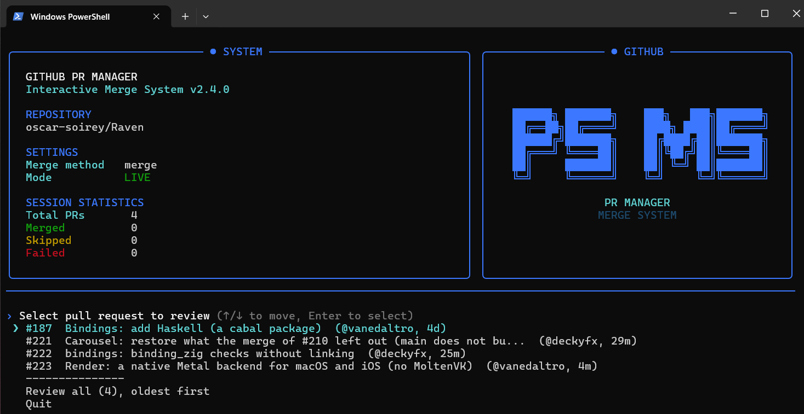

<h1 align="center">Git PR Manager</h1>

<p align="center">
  A simple, interactive CLI to review and merge GitHub pull requests safely.
</p>

<p align="center">
  <a href="https://github.com/oscar-soirey/Git-PR-Manager/issues">
    
  </a>
  <a href="https://github.com/oscar-soirey/Git-PR-Manager/releases">
    
  </a>
  <a href="https://github.com/oscar-soirey/Git-PR-Manager/pulls">
    
  </a>
  <a href="https://www.python.org/">
    
  </a>
</p>

<p align="center">
  
</p>

---

## Features

- **Arrow-key interface**: browse and review your open pull requests right from the terminal.
- **At-a-glance details**: author, branches, changes (`+/-`), CI status, review decision, mergeability, labels and age.
- **Risk warnings**: failing or running CI, requested changes, missing required review.
- **Diff viewer** and **open in browser** without leaving the tool.
- **Safe merges**: every merge goes through GitHub itself, so branch protection rules still apply, and the merge is refused if the PR was updated after you reviewed it.
- **Per-file conflict resolution**: for each conflicted file, keep the *current* version (base branch) or take the *incoming* one (the PR), like in VS Code.
- **Auto mode**: merge every open PR in one command, no questions asked.
- **Dry run**: go through the whole process without merging anything.
- **Audit log** of every action taken.

## Requirements

- Python 3.9+
- [GitHub CLI (`gh`)](https://cli.github.com), installed and authenticated (`gh auth login`)
- [`rich`](https://github.com/Textualize/rich)
- [`questionary`](https://github.com/tmbo/questionary)

## Installation

```bash
git clone https://github.com/oscar-soirey/Git-PR-Manager.git
cd Git-PR-Manager
pip install rich questionary
```

## Usage

Run it from inside a clone of your repository, and follow the instructions:

```bash
python pr_manager.py
```

Or target any repository directly, no local clone needed:

```bash
python pr_manager.py -R owner/name
```

If no repository is detected, the tool asks for a path to a local clone or an `owner/name`.

### Examples

```bash
# Squash-merge and delete the branch afterwards
python pr_manager.py --method squash --delete-branch

# Review everything, merge nothing
python pr_manager.py --dry-run

# Only PRs targeting `main` by a given author, drafts included
python pr_manager.py --base main --author octocat --include-drafts

# Merge every open PR automatically
python pr_manager.py -R owner/name --auto

# Same, and resolve every conflict by taking the PR's version
python pr_manager.py -R owner/name --auto --force incoming
```

### Parameters

| Option | Description |
| --- | --- |
| `-R`, `--repo owner/name` | Repository to use (default: the one in the current directory) |
| `--base BRANCH` | Only list PRs targeting this base branch |
| `--author USER` | Only list PRs opened by this GitHub user |
| `--include-drafts` | Also list draft PRs (hidden by default) |
| `--method {merge,squash,rebase}` | Merge method (default: `merge`) |
| `--delete-branch` | Delete the head branch after merging |
| `--dry-run` | Review only, never merge |
| `--auto` | Merge every open PR automatically, without any prompt |
| `--force {current,incoming}` | With `--auto`: resolve every conflict, in every PR and file, with that side |
| `--version` | Show the version |

## How it works

PRs are listed **oldest first**, so the ones waiting the longest get reviewed first. For each one you can merge it, view its diff, open it in your browser, skip it, or quit.

### Conflict resolution

When a PR has conflicts, the tool offers to resolve them file by file. The merge happens in a **temporary git worktree**, so your working directory, branch and uncommitted changes are never touched. Only files that really conflict are asked about, git handles the rest.

> [!WARNING]
> A resolved merge is pushed **directly** to the base branch (never forced), which bypasses PR review rules. The tool asks for confirmation before pushing. Conflict resolution requires running the tool from a local clone of the repository.

### Auto mode

`--auto` merges every open PR, oldest first, without asking anything. PRs with conflicts are **skipped** (resolving them needs a human choice), and any PR that GitHub refuses to merge, for example because of branch protection, is reported as failed while the run continues.

#### `--auto --force current|incoming`

Add `--force` to resolve conflicts too, without any prompt: `current` keeps the version already on the base branch, `incoming` takes the version from the PR. The same side is applied to **all conflicted files of all PRs**. Each conflicting PR is merged in a temporary worktree and pushed **directly** to the base branch (never forced), so it bypasses PR review rules and needs a local clone of the repository. `--force` is refused without `--auto`.

### Audit log

Every action (merged, skipped, failed, dry run...) is appended to:

```
~/.pr_manager/history.jsonl
```

The tool exits with code `1` if at least one merge failed, which makes it usable in scripts.

## Contributing

Issues and pull requests are welcome, feel free to [open an issue](https://github.com/oscar-soirey/Git-PR-Manager/issues).